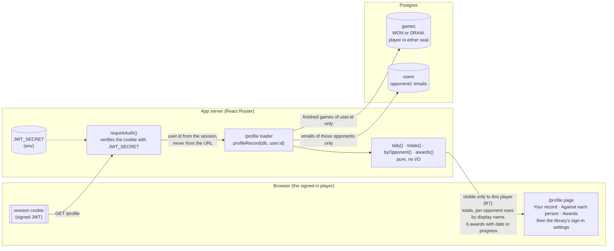

# Profile record design

How the profile page meets R1–R7 in [the profile record requirements](../requirements/profile-record.md), for [#105](https://github.com/activescott/four-in-a-row/issues/105). Nothing new is stored: the `/profile` loader reads the player's finished games once and works out the record, the per-opponent list and the awards from them.

## Prior work

Searched on 2026-11-27:

- `docs/`: only `docs/requirements/profile-record.md` (#116). There is no earlier design doc.
- Pull requests, merged and open (`gh pr list --state all --search` for profile, record, award, head-to-head and wins): #88 "head-to-head record on Your games and the game page" added `tally()` and `recordsFor()` in `app/game/record.server.ts` and the score line in `app/routes/games.tsx` and `app/routes/games.$id.tsx`. #47 added `displayName()`'s clash handling. #68 and #75 shaped today's `/profile` page. The only open PRs are Renovate's (#11, #111).
- Issues, open and closed, with the same terms: #87 (keep score between two players, met by #88), #94 (a second email address on the profile, unrelated), #2 (the app's design). Nothing else mentions awards or an overall record.
- `git grep -i` for profile, record, award, head-to-head and wins: `app/game/record.server.ts`, `app/game/display.ts` (`displayName`, `drawsLabel`), `app/routes/profile.tsx`, and their tests. No code computes an overall total or any award.

Nothing already covers this. The design reuses:

- `tally()`, unchanged, for the per-opponent wins, losses and draws (R2), and its sum for the overall record (R1).
- The `recordsFor()` query shape: finished games where the player is in either seat.
- `displayName(email, others)` for opponent names and `drawsLabel()` for "1 draw".
- The score line markup ("You 7 · grandma 5 · 1 draw") and `Wrappable`, moved into one component so all three places render the same form.
- `requireAuth` and the existing `/profile` route and page.

## Data flow



Nothing on the page is public. The record and awards go only to the player whose session cookie made the request (R7). No route takes another player's id, and the loader sends no user ids and no opponent emails, only display names, which are the names that player already sees on Your games.

## Design

### Data model (R6)

No schema change and no migration. Everything comes from existing `games` columns: `status`, `winnerId`, `finishedAt`, `playerOneId`, `playerTwoId`. `finishedAt` is set on every WON and DRAW game today (`app/game/games.server.ts`), so games played before this ships count at once.

### Query (R1, R2, R4, R6, R7)

A new `profileRecord(db, userId)` in `app/game/record.server.ts` runs two queries:

1. The player's finished games, as `recordsFor()` does, also selecting `finishedAt` and `id`, ordered by `finishedAt` then `id`:

   ```ts
   db.game.findMany({
     where: {
       status: { in: ["WON", "DRAW"] },
       OR: [{ playerOneId: userId }, { playerTwoId: userId }],
     },
     select: { id, playerOneId, playerTwoId, status, winnerId, finishedAt },
     orderBy: [{ finishedAt: "asc" }, { id: "asc" }],
   });
   ```

2. The emails of the opponents in those games, as `listGames()` does.

The existing `playerOneId` and `playerTwoId` indexes serve query 1. A family player has tens or hundreds of finished games, so reading them all on each page load is cheap; no pagination or caching.

`recordsFor()` and its callers stay as they are.

### Overall record (R1, R3)

`totals(records)` sums the `HeadToHead` values from `tally()`: `{ played, won, lost, drawn }`. Summing `tally()` rather than counting again keeps the total and the per-opponent rows from ever disagreeing.

The **Your record** card reads:

- `played > 0`: "12 wins out of 20 games", then "7 lost · 1 draw" (`drawsLabel()`, left out when there are no draws). Singular forms: "1 win out of 1 game". No percentage.
- `played === 0` (R3): "No finished games yet". The **Against each person** card is not rendered at all.

### Against each person (R2)

`byOpponent(records, emails)` turns the `tally()` map into rows `{ name, won, lost, drawn }`:

- `name` is `displayName(email, allOpponentEmails)`, the same call `games.tsx` makes, so bob@a.com and bob@b.com show in full.
- Order: games played (`won + lost + drawn`) descending, then `name` ascending with `Intl.Collator("en", { sensitivity: "base" })`, so "Grandma" and "grandma" sort together and "jonah" comes before "micah".
- Only opponents with at least one finished game appear, because `tally()` only has entries for them.

Each row renders through a new `ScoreLine` component (`app/game/score-line.tsx`): "You {won} · {name} {lost}", then " · 1 draw" when there are draws, with the name in `Wrappable`. `games.tsx` and `games.$id.tsx` switch to it, so the profile can't drift from "the same form as the existing score line". Their `data-record` attribute and classes move with it, so their tests and e2e selectors don't change.

### Awards (R4, R5)

A pure `awards(games, userId)` in a new `app/game/awards.ts` walks the ordered games once and returns all six, in R4's order:

```ts
type Award = {
  id:
    | "first-win"
    | "ten-wins"
    | "hat-trick"
    | "full-board"
    | "regular"
    | "rematch";
  name: string; // "First win"
  howTo: string; // "Win a game"
  earnedAt: Date | null; // finishedAt of the game that earned it
  progress: { have: number; need: number } | null; // null for one-step awards
};
```

| Award      | Earned by the game that…                                                 | Progress while unearned                     |
| ---------- | ------------------------------------------------------------------------ | ------------------------------------------- |
| First win  | is the player's 1st win                                                  | none ("Win a game")                         |
| Ten wins   | is the 10th win                                                          | wins so far, "6 of 10"                      |
| Hat trick  | is the 3rd win in an unbroken run; a draw or loss resets the run to 0    | longest run so far, "best run 2 of 3"       |
| Full board | is the player's 1st draw                                                 | none ("Draw a game")                        |
| Regular    | is the 25th finished game, any result                                    | games so far, "20 of 25 games"              |
| Rematch!   | is the 5th finished game against one opponent, first opponent to reach 5 | most games against any one person, "3 of 5" |

Each award is earned once: the first game to cross the threshold sets `earnedAt`, and later games don't move it. "Against anyone" for Hat trick needs nothing extra: the run is over all the player's games in `finishedAt` order. `rematchOfId` plays no part in Rematch!, as R4 says. Games with equal `finishedAt` are ordered by `id`, so the result is the same on every load.

The **Awards** card lists earned awards first, oldest `earnedAt` first, then unearned ones in R4's order. Earned: name and the date ("14 Nov 2026"). Unearned (R5): greyed (`text-slate-600`, the app's existing muted colour, which passes 4.5:1 on white), with `howTo` and, where there is one, the progress line. The card shows the same six with no finished games (R3).

The earned state isn't carried by colour alone: each row has a visually hidden "Earned" or "Not earned yet" for screen readers, and a check or empty-circle glyph marked `aria-hidden`.

### Route and loader (R1–R7)

No new route. The `/profile` loader in `app/routes/profile.tsx` adds one call:

```ts
const user = await requireAuth(request);
return {
  email: user.email,
  memberSince: user.createdAt,
  record: await profileRecord(db, user.id),
  ...(await profileAuthLoader(user.id, request)),
};
```

`record` is `{ totals, opponents: { name, won, lost, drawn }[], awards: Award[] }`, with `earnedAt` sent as an ISO string. `requireAuth` redirects a signed-out request to `/login` before anything is read (R7).

### Page (R1, R2, R3, R5)

`profile.tsx` renders three new cards, in a new `app/game/profile-record.tsx` (`RecordCard`, `OpponentsCard`, `AwardsCard`), above `<ProfilePage>`, so they come first and the sign-in settings follow unchanged. The cards reuse `LIGHT.card`'s look (`rounded-lg border border-slate-300 bg-white`) and each has an `h2`. The library's `ProfilePage` is not changed.

### Traceability

| Requirement                     | Met by                                                                                              |
| ------------------------------- | --------------------------------------------------------------------------------------------------- |
| R1 Your record, first, in words | [Overall record](#overall-record-r1-r3), [Page](#page-r1-r2-r3-r5)                                  |
| R2 Against each person, ordered | [Against each person](#against-each-person-r2)                                                      |
| R3 No finished games yet        | [Overall record](#overall-record-r1-r3)                                                             |
| R4 The six awards               | [Awards](#awards-r4-r5)                                                                             |
| R5 Greyed with progress; date   | [Awards](#awards-r4-r5)                                                                             |
| R6 Worked out on load           | [Data model](#data-model-r6), [Query](#query-r1-r2-r4-r6-r7)                                        |
| R7 Only you see yours           | [Data flow](#data-flow), [Route and loader](#route-and-loader-r1r7), [Query](#query-r1-r2-r4-r6-r7) |

## Test plan

Unit tests run in Vitest with a fresh PGlite database per file, as today.

| Requirement | Test                                                                                                                                                                                                                                                                                                                                                                                                           |
| ----------- | -------------------------------------------------------------------------------------------------------------------------------------------------------------------------------------------------------------------------------------------------------------------------------------------------------------------------------------------------------------------------------------------------------------- |
| R1          | `record.server.test.ts`: `totals()` sums wins, losses and draws across opponents and seats. `profile-record.test.tsx`: the card renders "12 wins out of 20 games" and "7 lost · 1 draw", "1 win out of 1 game", and no "%".                                                                                                                                                                                    |
| R2          | `byOpponent()`: most games first; equal counts in name order, case-insensitive; clashing local parts show full addresses. Render test: each row has the same text as the games-list score line for the same record.                                                                                                                                                                                            |
| R3          | Render test: no finished games gives "No finished games yet", no Against each person heading, and all six awards unearned.                                                                                                                                                                                                                                                                                     |
| R4          | `awards.test.ts`, one test per award at the threshold and one game short: 1st and 10th win; a W W D W W W run earns Hat trick on the 6th game, and W W L W W does not; a draw earns Full board; the 25th game earns Regular; 5 games against jo earns Rematch! when 4 each against three people do not. Rematch! counts games with no `rematchOfId`. Each is earned once: later games don't change `earnedAt`. |
| R5          | `awards.test.ts`: `earnedAt` is the `finishedAt` of the earning game; progress is "6 of 10", best run, games so far, most against one person. Render test: earned awards first, oldest first; unearned ones greyed with `howTo` and progress.                                                                                                                                                                  |
| R6          | `profile.test.ts` (route): games created directly in the database before the first load all count; a game finished between two loads counts on the second. No migration in the PR.                                                                                                                                                                                                                             |
| R7          | `profile.test.ts`: a signed-out request is redirected to `/login`; player C's profile has nothing from a game between A and B, and the loader data holds no user ids and no opponent emails except where `displayName()` shows one.                                                                                                                                                                            |

The existing record tests in `games.test.ts` must still pass after the score line moves into `ScoreLine`.

e2e, added to `e2e/full-game.spec.mts` after its game ends in a win: the winner opens `/profile` and sees "1 win out of 1 game", one row "You 1 · {loser} 0", First win earned with today's date, and Ten wins "1 of 10"; the loser sees "0 wins out of 1 game" and First win greyed. This runs in mobile WebKit, desktop Chromium and desktop Firefox, as today. The existing dark-mode check in `e2e/nav.spec.mts` covers the new cards' light background.

## Risks and open questions

1. **Which day an award's date shows.** The server renders the page, and `finishedAt` is UTC: a game won at 8 pm in California on 14 Nov is 15 Nov in UTC. Formatting in the browser's own zone would differ between the server render and hydration. Recommended: format on the server in one fixed zone, `America/Los_Angeles`, since the family's times in #105 and #87 are Pacific. Scott to confirm the zone, or say every player should see their own, which needs a time-zone cookie or a client-only date.

No other open questions.

## Build plan

One implementation PR, `feat: show your record and awards on the profile`, part of #105:

1. Move the score line into `app/game/score-line.tsx` and use it in `games.tsx` and `games.$id.tsx`. Existing tests stay green, with no change to what they assert.
2. Add `totals()`, `byOpponent()` and `profileRecord()` to `app/game/record.server.ts`, tests first.
3. Add `app/game/awards.ts` with `awards()`, tests first, one per award.
4. Add the three cards in `app/game/profile-record.tsx` and render them above `<ProfilePage>` in `profile.tsx`, with the loader change and the route tests.
5. Extend `e2e/full-game.spec.mts` with the profile check.
6. Before and after screenshots of `/profile` at phone width in the PR (with games, and with none), for review against the requirements' layout.

Done when CI is green and Scott and Olya approve. #105's own check, Micah seeing his record on production, follows the release.
